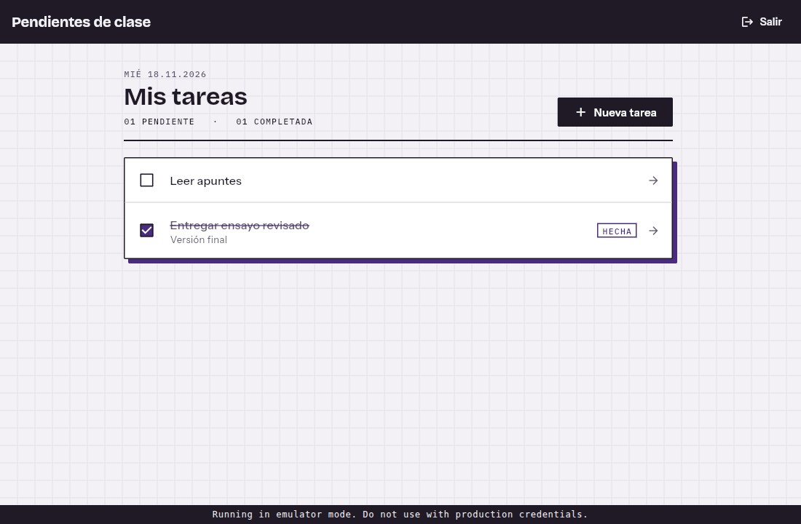

# Pendientes de clase

[](https://github.com/khoopper/practica-integracion-pruebas-flutter/actions/workflows/integracion-y-pruebas.yml)

Práctica de integración y pruebas de **Flutter Web**. La aplicación permite crear una cuenta, iniciar sesión y gestionar tareas privadas guardadas en Firebase. La rama de la práctica es `semana16-integracion`.

- **Estudiante:** Brandon Ramirez (entrega individual)
- **Repositorio:** [github.com/khoopper/practica-integracion-pruebas-flutter](https://github.com/khoopper/practica-integracion-pruebas-flutter) · rama `semana16-integracion`
- **Servicios de Firebase:** Authentication (correo y contraseña) y Cloud Firestore. Storage y FCM quedan fuera del alcance.

## Resultados en breve

| Indicador | Resultado |
| --- | --- |
| Casos ejecutados | 17 de 22 planificados (5 fuera del alcance: Storage y FCM), en dos rondas |
| Flujos críticos aprobados | 100 % (17 ÷ 17) |
| Incidencias | 7 registradas (INC-001 a INC-007), 7 corregidas con commit `fix: INC-00X` y re-probadas |
| `flutter test` | 9 pruebas en verde: 3 unitarias y 6 de widget con repositorio falso |
| `flutter analyze` | 4 diagnósticos informativos al inicio · «No issues found!» al final |
| Integración continua | `flutter analyze`, `flutter test` y las dos rondas de casos funcionales se ejecutan en cada push en GitHub Actions |
| Firebase en la nube | CP-07 y CP-09 repetidos en el proyecto de prueba `practica-flutter-pruebas`, con capturas de Firebase Console |



## Diseño

La interfaz se inspira en un cuaderno de cuadrícula: fondo de papel cuadriculado, hojas blancas con borde de tinta y sombra sólida, botones y campos rectangulares, y un único acento violeta de sello para los estados («HECHA», «Completada»). Los errores y avisos usan fichas con etiqueta en lugar de colores de alerta. Las tipografías Bricolage Grotesque, Instrument Sans e IBM Plex Mono van incluidas en `assets/fonts/` con su licencia SIL Open Font License 1.1.

## Ejecutar la aplicación

Se verificó con Flutter 3.50.0, Dart 3.14.0, Firebase CLI 15.36.0, Node.js 24, Java 21 y Chrome Headless Shell. Para abrirla manualmente se puede usar Chrome. Firebase usa por defecto el proyecto local `demo-practica-flutter`.

Desde la raíz del proyecto, instala dependencias y deja ejecutándose esta primera terminal.

```bash
flutter pub get
firebase emulators:start --project demo-practica-flutter --only auth,firestore
```

En otra terminal, inicia la app.

```bash
flutter run -d chrome --web-hostname=127.0.0.1 --web-port=7357 --no-web-resources-cdn
```

Crea una cuenta de prueba con un correo de ejemplo y una contraseña de seis o más caracteres. Abre **Nueva tarea**, guarda un título y selecciona la tarea para editarla. La casilla de la lista cambia su estado a completada. La consola de emuladores abre en [127.0.0.1:4000](http://127.0.0.1:4000).

## Integración continua

| Flujo | Qué hace | Cuándo |
| --- | --- | --- |
| [Integración y pruebas](.github/workflows/integracion-y-pruebas.yml) | `flutter analyze`, `flutter test`, compilación web y dos rondas de casos funcionales con emuladores de Auth y Firestore. Publica salidas y capturas como artefactos. | En cada push a `main` o `semana16-integracion` |
| [Regresión INC-003](.github/workflows/regresion-inc-003.yml) | Ejecuta la prueba de INC-003 en `2654ecf` (debe fallar) y en la versión corregida (debe pasar). | Manual, para la repetición en clase |
| [App web contra Firebase en la nube](.github/workflows/web-nube.yml) | Compila la app con la configuración de un proyecto de prueba guardada en secretos del repositorio. | Manual |

## Ejecutar las pruebas

```bash
flutter analyze
flutter test --reporter expanded
```

La validación funcional usa Python 3 y Playwright. Mantén los emuladores abiertos e inicia Flutter con estas opciones para habilitar los controles accesibles desde el arranque.

```bash
flutter run -d web-server --release --web-hostname=127.0.0.1 --web-port=7357 --no-web-resources-cdn --dart-define=ENABLE_TEST_SEMANTICS=true
```

En una tercera terminal instala el navegador de pruebas y ejecuta dos rondas con cuentas ficticias nuevas.

```bash
python -m pip install playwright
python -m playwright install chromium
python integration_test/validar_web.py
```

Puedes pasar `--chrome RUTA_DEL_EJECUTABLE` para usar otro Chromium. `--evidencias` vuelve a capturar las imágenes en `docs/evidencias/`. Durante el caso sin conexión Playwright desactiva temporalmente la red del navegador de prueba. Flutter Web conecta cada campo y cada botón unos cuadros después de mostrarlos, así que el verificador espera a que el texto escrito se conserve y repite un clic de Auth solo si la solicitud no llegó a salir.

## Atestados

| Archivo | Contenido |
| --- | --- |
| [Declaración de alcance](docs/01-declaracion-alcance.md) | Módulos, plataforma y entorno |
| [Mapa de flujos críticos](docs/02-mapa-flujos-criticos.md) | Recorridos y casos asociados |
| [Plantilla de pruebas](docs/03-plantilla-pruebas.md) | Integración incremental, entradas, expectativas, resultados y evidencia |
| [Plantilla oficial 08 (Markdown)](docs/08-plantilla-pruebas-e-incidencias.md) | Encabezado, alcance, registro de pruebas e incidencias, resumen y ficha de cada incidencia |
| [Plantilla oficial 08 (CSV)](docs/08_Plantilla_pruebas_e_incidencias.csv) | Las mismas filas del registro para abrir en Excel u hojas de cálculo |
| [Registro de incidencias](docs/04-registro-incidencias.md) | Causas, correcciones, commits y regresiones |
| [Reflexión final](docs/05-reflexion-final.md) | Aprendizaje de la incidencia de guardado |
| [Capturas de la aplicación](docs/evidencias/capturas-aplicacion/) | Evidencia del flujo principal |
| [Capturas de Firebase](docs/evidencias/firebase/) | Consola local de emuladores (01 a 03) y Firebase Console en la nube (04 y 05): cuentas ficticias y tareas creadas y actualizadas |
| [Pruebas y análisis](docs/evidencias/pruebas-y-analisis/) | Salidas de ejecución reproducibles |

## Ejecutar con Firebase en la nube

Para tomar las capturas solicitadas en Firebase Console, crea un proyecto de prueba y registra una app web. Habilita **Correo electrónico/contraseña** en Authentication e inicializa Firestore. Copia `firebase.local.example.json` a `firebase.local.json` y completa las opciones web del proyecto. El archivo local está excluido de Git.

Aplica `firestore.rules` en el proyecto de prueba y arranca Flutter con su configuración.

```bash
firebase login
firebase deploy --project ID_DEL_PROYECTO_DE_PRUEBA --only firestore:rules
flutter run -d chrome --dart-define-from-file=firebase.local.json
```

Si en el equipo no se puede ejecutar Flutter, el flujo [App web contra Firebase en la nube](.github/workflows/web-nube.yml) compila la app con los valores guardados como secretos del repositorio (`FIREBASE_PROJECT_ID`, `FIREBASE_APP_ID`, `FIREBASE_API_KEY`, `FIREBASE_MESSAGING_SENDER_ID` y `FIREBASE_AUTH_DOMAIN`). El artefacto `web-nube` se sirve con `python -m http.server 5000` y se abre en `http://localhost:5000`.

Usa cuentas ficticias. Crea y modifica una tarea, y captura los datos en Firestore de Firebase Console. Guarda esas capturas en `docs/evidencias/firebase/` con nombres que indiquen la operación. Así se tomaron `04-firestore-nube-tarea-creada.png` y `05-firestore-nube-tarea-modificada.png` en el proyecto de prueba `practica-flutter-pruebas`; las capturas 01 a 03 proceden de la consola local de emuladores.

## Clonar el repositorio

```bash
git clone --branch semana16-integracion https://github.com/khoopper/practica-integracion-pruebas-flutter.git
```

Las correcciones se identifican en el historial con el formato `fix: INC-00X descripción`.

```bash
git log --oneline --grep "INC-"
```

## Lista de autoverificación

- [x] Declaré mi alcance real ([01](docs/01-declaracion-alcance.md) y sección 0 de la [plantilla 08](docs/08-plantilla-pruebas-e-incidencias.md)).
- [x] Cada caso tiene datos de entrada y resultado esperado concretos.
- [x] Registré el resultado obtenido de cada caso, no solo «ok».
- [x] Cada incidencia tiene causa y corrección, con commit y prueba de regresión.
- [x] Las evidencias se pueden abrir y cada caso enlaza la que lo prueba.

## Referencias

- Configuración de Firebase para Flutter. [Documentación de Firebase](https://firebase.google.com/docs/flutter/setup)
- Conexión de Firestore al emulador. [Documentación de Firebase](https://firebase.google.com/docs/emulator-suite/connect_firestore)
- Migración a `material_ui`. [Documentación de Flutter](https://docs.flutter.dev/release/breaking-changes/material-ui-and-cupertino-ui)
- Creación de repositorios desde la terminal. [Manual de GitHub CLI](https://cli.github.com/manual/gh_repo_create)
